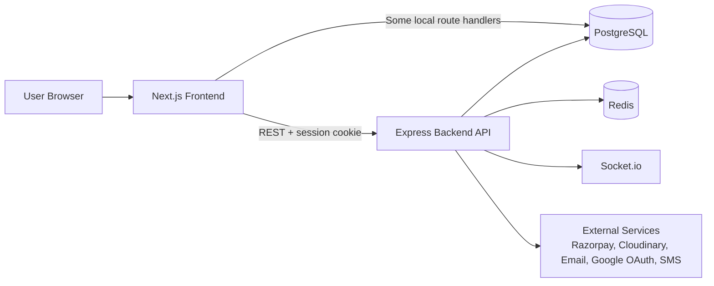
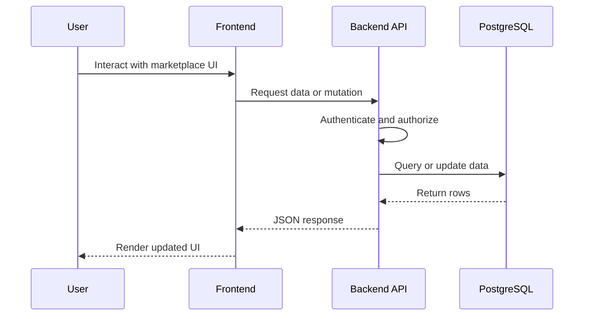
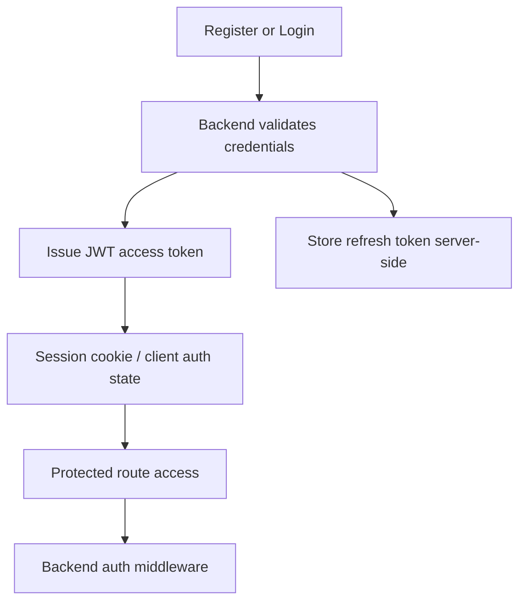
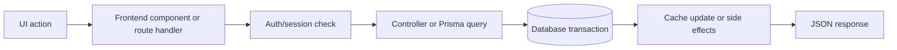
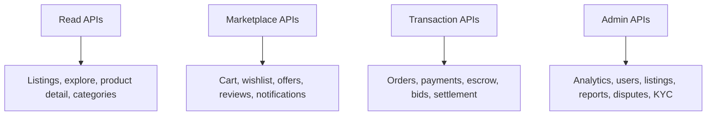
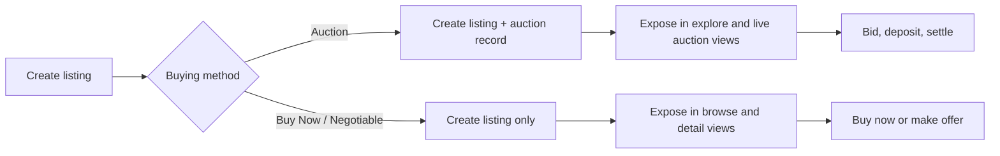
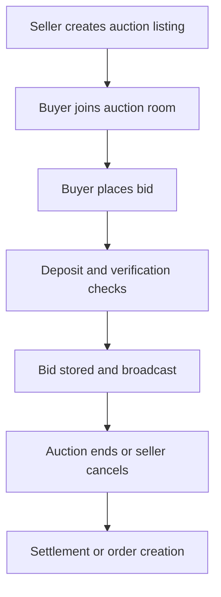
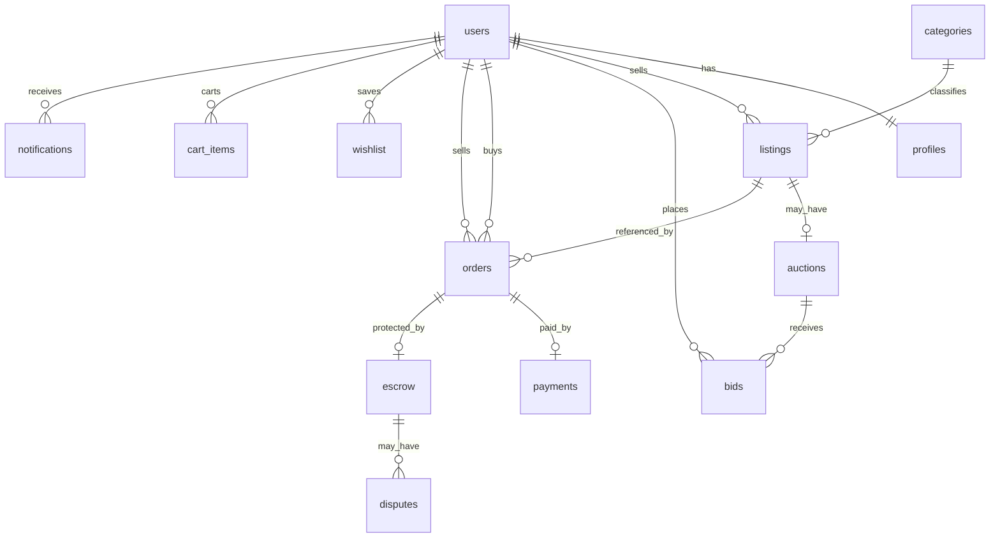

# BidCraft


BidCraft is a creator marketplace for discovering, buying, offering on, and auctioning unique items with escrow-backed transactions, seller tools, and marketplace trust features.

## Overview

The repository contains two coordinated applications:

- `frontend/`: a Next.js 16 App Router client with server components, interactive marketplace UI, and a small set of Next.js route handlers.
- `backend/`: an Express 5 API that owns the main marketplace workflows, payment and escrow logic, auctions, moderation, and realtime auction events.

The system uses PostgreSQL as the source of truth, Redis for caching hot reads, Socket.io for auction updates, and external services for payments, media, email, identity, and messaging.

## Purpose

BidCraft aims to give creators, collectors, and buyers a single place to browse listings, join auctions, make offers, complete secure checkout, and manage orders with escrow protection.

## Problem Statement

Generic marketplaces often lack the combination of curated discovery, trust signals, auction support, and buyer protection needed for high-confidence transactions. BidCraft addresses that gap with a marketplace-oriented product model and escrow-first order flow.

## Motivation

The repository is designed around a simple product goal: make unique-item commerce feel safe and operationally complete without sacrificing discoverability or seller flexibility. Auctions, offers, shipping, reviews, and admin review are all part of that flow.

## Key Features

| Module | Implemented capabilities |
|---|---|
| Authentication | Email/password login, Google OAuth, email verification, password reset, refresh tokens, server session checks |
| Listings | Browse, detail, create, update, delete, category filters, image upload, seller listings |
| Marketplace | Home page merchandising, explore filters, product detail pages, categories, collections, creator and collection sections |
| Auctions | Live auctions, bid placement, bid deposits, auction settlement, cancellation, realtime room support |
| Offers | Make offer, accept offer, reject offer |
| Orders | Order creation, order detail pages, order status, shipping, buyer and seller order views |
| Payments | Razorpay checkout, signature verification, webhook handling, card token setup |
| Notifications | In-app notifications and notification UI |
| Admin | Analytics, user management, listing moderation, reports, disputes, KYC review |
| Security | JWT auth, role checks, rate limiting, Joi validation, image validation, escrow flow |
| Caching | Redis-backed caching for product, listing, and seller reputation reads |

## Technology Stack

| Area | Technologies |
|---|---|
| Frontend | Next.js 16, React 19, TypeScript, Tailwind CSS, Framer Motion, Zustand |
| Backend | Node.js, Express 5, Socket.io, JWT, Joi, bcryptjs, multer |
| Database | PostgreSQL, node-pg-migrate, Prisma (frontend route handlers) |
| Authentication | JWT access tokens, refresh tokens, Google OAuth, cookie-based server session checks |
| Storage | PostgreSQL, Redis, Cloudinary |
| Deployment | Targeted for modern Node hosting and Vercel-style frontend deployment; no Docker or deployment manifests are committed |
| External Services | Razorpay, Cloudinary, Upstash Redis, Resend/SMTP, Google OAuth, Twilio, shipping provider abstractions |
| Developer Tools | Jest, Supertest, Playwright, Prisma, nodemon, node-pg-migrate, ESLint, TypeScript |

## Folder Structure

| Path | Purpose |
|---|---|
| `frontend/` | Next.js client application, UI components, client state, Prisma-backed route handlers |
| `backend/` | Express API, controllers, services, middleware, migrations, tests |
| `docs/` | Architecture notes, audits, decision records, and planning documents |
| `tools/` | Reusable developer utility scripts, maintenance, and audits |
| `archive/` | Legacy components, old pages, and historical artifacts |
| `scripts/` | Maintenance, seed, and data migration scripts |
| `shared/` | Shared data and category definitions |
| `images/` | Asset and media files |

## Architecture Overview

BidCraft uses a hybrid client-server architecture. The frontend renders the marketplace UI and handles user interaction, while the backend owns the main business workflows and database mutations. Some frontend Next.js route handlers also read and write database records directly through Prisma, so the repository has more than one API surface.

### High-Level Architecture



### Frontend -> Backend Flow



### Authentication Flow



### Request Lifecycle



### API Flow



### Listing Lifecycle



### Auction Workflow



### Database ER Diagram



## Database Overview

The backend schema centers on marketplace entities and transaction safety.

| Area | Summary |
|---|---|
| Core tables | users, profiles, categories, listings, auctions, bids, orders, payments, escrow, shipments, reviews, disputes |
| Trust and workflow tables | refresh_tokens, verification_codes, notifications, wishlist, follows, cart_items, listing_questions, reports, bid_deposits |
| Relationships | listings belong to sellers, auctions belong to listings, bids belong to auctions, orders tie buyers and sellers to listings or auctions, escrow is one-to-one with orders |
| Constraints | Unique pairs for wishlist/cart/deposits, status enums, foreign keys, check constraints on amounts and statuses |
| Indexes | Listing category/search, bid lookup, auction end time, order and notification lookups, seller reputation and hot feed paths |
| Migrations | node-pg-migrate is the source of truth; `db/schema.sql` is a legacy baseline for the initial migration |

## API Overview

| API group | Responsibility |
|---|---|
| Auth | Register, login, Google OAuth, email verification, password reset, refresh/logout, session identity |
| Listings | CRUD, image upload, live auctions, new arrivals, browse filters |
| Auctions and bids | Auction create/cancel/settle, bid placement, bid deposits, decision handling |
| Orders and payments | Checkout, payment verification, webhook handling, payment history, card token setup |
| Escrow and shipping | Shipment tracking, delivery confirmation, dispute handling, escrow release |
| Social and marketplace | Offers, wishlist, cart, follows, reviews, questions, notifications |
| Admin | Analytics, users, listings, reports, disputes, KYC review |
| Frontend route handlers | Product listing/detail, cart, wishlist, and bid proxy routes backed by Prisma |

## Installation

### Prerequisites

- Node.js 20 or newer
- npm
- PostgreSQL
- Access to the external services you plan to use in the environment

### Clone

```bash
git clone <repository-url>
cd BidCraft
```

### Install

Install dependencies for both applications:

```bash
cd backend
npm install

cd ../frontend
npm install
```

### Environment Variables

Create environment files for the backend and frontend. The repository does not currently include `.env.example` files, so the list below is the practical template.

### Run Backend

```bash
cd backend
npm run dev
```

### Run Frontend

```bash
cd frontend
npm run dev
```

### Database setup

- Configure `DATABASE_URL` for the backend and frontend Prisma access.
- Run the backend migrations with `npm run migrate` from `backend/`.
- The initial schema is driven by migrations; `backend/db/schema.sql` is treated as legacy baseline material.

### Development mode

- Start the backend API first.
- Start the frontend second so browser flows can reach the API and session cookies.
- Use the same origin or configured frontend URL values expected by the environment.

### Production build

```bash
cd frontend
npm run build
npm start
```

The backend is started with `npm start` from `backend/`.

## Environment Variables

| Variable | Scope | Purpose |
|---|---|---|
| `DATABASE_URL` | Backend, frontend Prisma | PostgreSQL connection string |
| `JWT_SECRET` | Backend, frontend session verification | JWT signing and verification secret |
| `CRON_SECRET` | Backend | Protect cron-driven admin endpoints |
| `RAZORPAY_KEY_ID` | Backend, frontend checkout | Public Razorpay key identifier |
| `RAZORPAY_KEY_SECRET` | Backend | Razorpay signature verification and API auth |
| `RAZORPAY_WEBHOOK_SECRET` | Backend | Razorpay webhook verification |
| `FRONTEND_URL` or `FRONTEND_ORIGIN` | Backend | CORS origin and email link generation |
| `CLOUDINARY_CLOUD_NAME` | Backend | Media upload target |
| `CLOUDINARY_API_KEY` | Backend | Cloudinary auth |
| `CLOUDINARY_API_SECRET` | Backend | Cloudinary auth |
| `UPSTASH_REDIS_REST_URL` | Backend, frontend cache layer | Redis cache endpoint |
| `UPSTASH_REDIS_REST_TOKEN` | Backend, frontend cache layer | Redis auth token |
| `GOOGLE_CLIENT_ID` | Backend | Google OAuth verification |
| `RESEND_API_KEY` | Backend | Email delivery |
| `SMTP_HOST`, `SMTP_PORT`, `SMTP_USER`, `SMTP_PASS` | Backend | Local or fallback email delivery |
| `KYC_API_KEY` | Backend | KYC provider integration |
| `SMS_API_KEY` | Backend | OTP/SMS delivery |
| `SHIPROCKET_API_KEY` or `DELIVERY_API_KEY` | Backend | Shipping integration |

## Usage Guide

1. Register or sign in through the auth page.
2. Complete email verification and onboarding if prompted.
3. Browse the home page, explore page, or category pages to discover listings.
4. Open a listing to buy now, make an offer, or join an auction.
5. Complete checkout or payment verification as required.
6. Track order status, shipping, notifications, and escrow state in the account area.
7. Sellers can create listings, review offers, manage orders, and settle auctions.

## Business Logic

| Workflow | Summary |
|---|---|
| Authentication | JWT access tokens plus refresh tokens, with email verification before full access |
| Listings | Fixed-price and auction listings share the same catalog, with automatic auction creation for auction listings |
| Auctions | Bids require verification and deposit checks in the backend workflow; realtime socket events broadcast auction room changes |
| Offers | Negotiable listings can receive offers, and sellers can accept or reject them |
| Payments | Razorpay orders and signatures are used to confirm payment before escrow is created |
| Escrow | Funds are held until shipping confirmation, buyer confirmation, or dispute resolution |
| Shipping | Seller shipment updates trigger OTP-based delivery confirmation flows |
| Moderation | Admin users can review reports, disputes, listings, and KYC decisions |

## Project Structure

| Folder | Major responsibility |
|---|---|
| `frontend/app/` | App Router pages and Next.js route handlers |
| `frontend/components/` | Shared UI, marketplace sections, dashboard widgets, and interactive panels |
| `frontend/lib/` | API helpers, auth/session helpers, Prisma client, caches, utilities |
| `frontend/store/` | Zustand auth state |
| `backend/src/routes/` | Express route registration |
| `backend/src/controllers/` | Request handling and business workflows |
| `backend/src/services/` | External integrations and reusable domain services |
| `backend/src/middleware/` | Auth, admin, and rate limiting helpers |
| `backend/src/utils/` | DB, logging, categories, validation, and cache helpers |
| `backend/migrations/` | Source-of-truth schema history |
| `docs/` | Architecture notes, audit reports, ADRs, and planning material |

## Deployment

The repo is structured for a modern frontend/backend split:

- Frontend: Vercel-style Next.js deployment is a natural fit.
- Backend: Node hosting such as Render, Railway, or a similar container-based Node environment is appropriate.
- Database: managed PostgreSQL is required.

Prerequisites:

- Backend and frontend environment variables must be configured.
- PostgreSQL migrations must be applied before the application starts.
- External service credentials must be present for production payment, media, email, and OTP flows.

Current repository note: no Dockerfile or platform-specific deployment manifest is committed.

## Current Status

BidCraft is a broad late-MVP codebase with many real marketplace flows implemented. The repo is functionally substantial, but it is not fully release-hardened because CI/CD, deployment configuration, env templates, and a few mock or fallback paths still need attention.

## Roadmap

- Add documented environment templates and release steps.
- Tighten deployment automation and CI coverage.
- Reduce duplication between the frontend API layer and the backend business logic.
- Continue replacing temporary or mock-only paths with explicit production integrations.
- Clean up historical artifacts, scratch files, and old patch outputs.

## Known Limitations

- No Docker or platform deployment manifests are committed.
- No `.env.example` files are present in the repo.
- The frontend and backend both contain API surfaces, so business logic is split across two layers.
- Some services fall back to mock behavior when external credentials are missing or when running in test/development.

## Contributing

Contributions are welcome. A future contribution guide should document:

- branch and PR expectations
- environment setup
- testing requirements
- linting and type-checking expectations
- schema migration policy

## License

License status: TBD.

## Acknowledgements

- Next.js
- Express
- PostgreSQL
- Prisma
- Socket.io
- Razorpay
- Cloudinary
- Resend
- Upstash Redis
