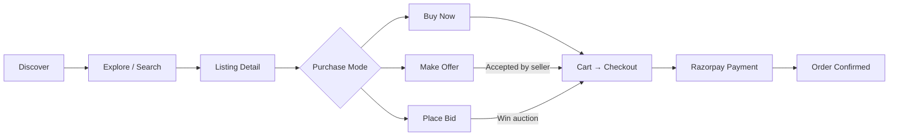
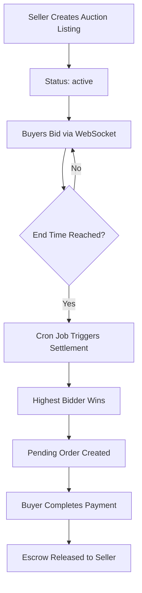
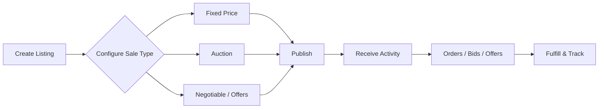
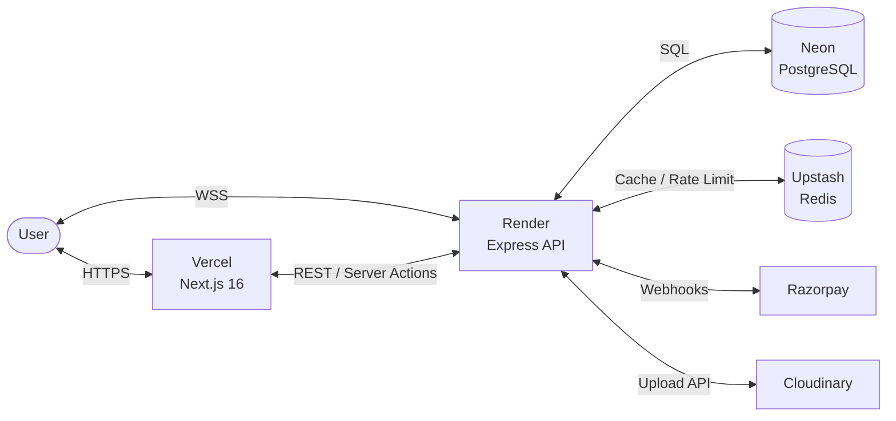
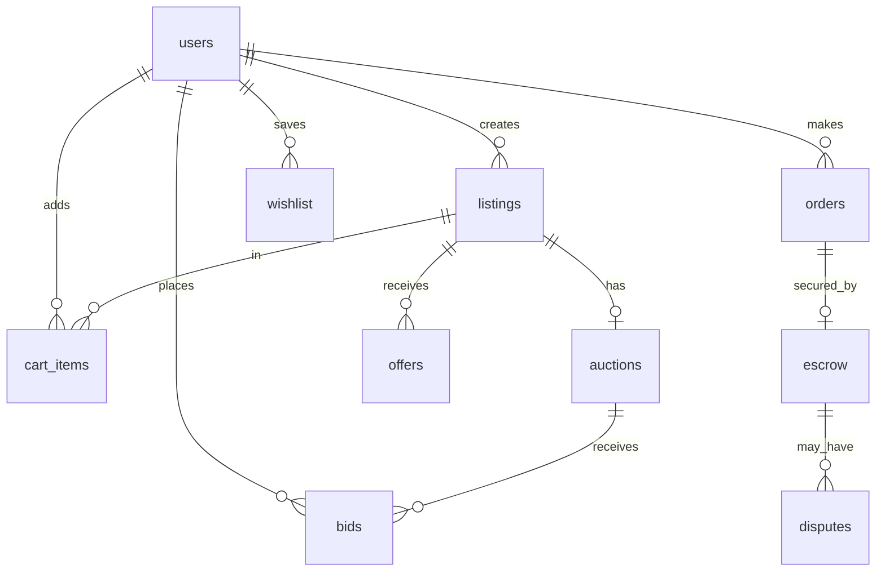
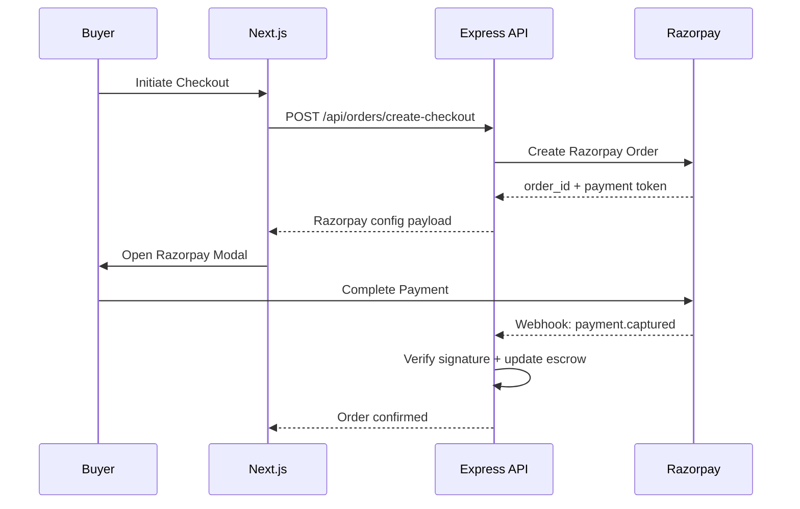
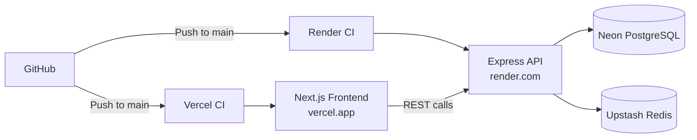

<div align="center">

```
  ██████╗ ██╗██████╗  ██████╗██████╗  █████╗ ███████╗████████╗
  ██╔══██╗██║██╔══██╗██╔════╝██╔══██╗██╔══██╗██╔════╝╚══██╔══╝
  ██████╔╝██║██║  ██║██║     ██████╔╝███████║█████╗     ██║   
  ██╔══██╗██║██║  ██║██║     ██╔══██╗██╔══██║██╔══╝     ██║   
  ██████╔╝██║██████╔╝╚██████╗██║  ██║██║  ██║██║        ██║   
  ╚═════╝ ╚═╝╚═════╝  ╚═════╝╚═╝  ╚═╝╚═╝  ╚═╝╚═╝        ╚═╝   
```

**Creator Marketplace — Auctions · Buy Now · Make Offers**

*A full-stack marketplace where creators sell and collectors discover through multiple transaction modes.*

[](https://nextjs.org)
[](https://nodejs.org)
[](https://postgresql.org)
[](https://vercel.com)
[](https://render.com)

</div>

---

## Navigation

[Overview](#overview) · [Features](#key-features) · [Product Flows](#product-flows) · [Architecture](#architecture) · [Tech Stack](#tech-stack) · [Security](#security--engineering) · [API](#api-reference) · [Setup](#local-setup) · [Deployment](#deployment) · [Testing](#testing) · [Roadmap](#roadmap)

---

## Overview

**BidCraft** is a production-grade creator marketplace that supports three parallel purchasing modes: **fixed-price purchases**, **live auctions**, and **private offer negotiation**. Rather than forcing a single transaction model, BidCraft lets sellers choose how they sell and lets buyers choose how they buy.

The backend is a decoupled Express REST API with Socket.io for real-time bid propagation, PostgreSQL for persistent state, and Redis for caching and rate limiting. The frontend is a Next.js 16 App Router application with an artisan aesthetic — warm typography, restrained layouts, and mobile-first responsiveness optimized for collectors and creators.

---

## Key Features

### Marketplace
- Category and subcategory browsing with server-side filtering
- Full-text search across listings
- Listing detail pages with image carousels, condition notes, and seller reputation
- Wishlist for saved listings

### Commerce
- **Buy Now** — fixed-price checkout via Razorpay
- **Cart** — multi-item basket with persistent server-side state
- **Make Offer** — private negotiation channel between buyer and seller
- **Escrow** — funds held securely until order confirmation

### Auctions
- **Live Bidding** — real-time bid propagation via Socket.io WebSockets
- **Countdown synchronization** — all clients share the same auction clock
- **Automated Settlement** — `node-cron` + external webhook trigger evaluates expired auctions, declares winners, and generates pending orders
- **Bid history and increment validation** on every bid event

### Seller
- Listing creation and management (Buy Now / Auction / Negotiable)
- Seller Dashboard with recent orders, active offers, and analytics
- Offer accept/reject workflow
- Order tracking with shipping number management

### Platform
- JWT authentication with refresh token rotation
- Email verification on signup via OTP
- Role-based access control (buyer, seller, admin)
- Rate limiting on sensitive endpoints
- Mobile-responsive across all viewport sizes

---

## Product Flows

### Buyer Journey



### Auction Lifecycle



### Seller Flow



---

## Architecture

BidCraft uses a clean three-tier decoupled architecture. The frontend, backend, and database are independently deployable.



### Database Schema

Core entities and relationships:



### Payment Flow



---

## Tech Stack

| Layer | Technology | Role |
|---|---|---|
| **Frontend** | Next.js 16 (App Router), React 19 | Web application |
| **Styling** | Tailwind CSS, Shadcn/ui, Framer Motion | UI, components, animations |
| **State** | Zustand, SWR | Client state & async data |
| **Backend** | Node.js, Express | REST API server |
| **Real-time** | Socket.io | Live auction WebSockets |
| **Database** | PostgreSQL, `node-pg-migrate` | Persistent data & migrations |
| **Cache** | Redis (Upstash) | Session cache & rate limiting |
| **Payments** | Razorpay | Payment processing & webhooks |
| **Media** | Cloudinary | Image upload & optimization |
| **Deployment** | Vercel (FE) / Render (BE) / Neon (DB) | Cloud hosting |

---

## Security & Engineering

### Authentication
- **Stateless JWT** access tokens (15 min expiry) with rotating refresh tokens (7 days)
- `httpOnly` session cookies set on login
- Tokens verified server-side in every protected Next.js API route via `jsonwebtoken`
- Email verification via SHA-256 hashed OTP before account activation

### Authorization
- Role-based middleware on all protected Express routes
- Ownership checks: only a listing's creator can accept offers or mutate listing state
- Buyer/seller role separation enforced at both API and UI levels

### Data Safety
- All SQL executed via parameterized `pg` queries — no raw string interpolation
- Input validated with `Joi` schema at every mutating endpoint
- `helmet` enforces HTTP security headers in production
- `express-rate-limit` prevents brute-force on auth and bidding endpoints (Redis-backed)
- CORS restricted to known frontend origins

### Auction Integrity
- Bid amount validated server-side against current highest bid + minimum increment
- Settlement is transactional — partial states are rolled back on failure
- Escrow records created atomically with order records

---

## Project Structure

```
BidCraft/
├── frontend/
│   ├── app/              # Next.js App Router pages and layouts
│   ├── components/       # Reusable UI and domain components
│   ├── lib/              # API clients, auth helpers, utilities
│   └── store/            # Zustand stores (auth, cart, wishlist)
├── backend/
│   ├── src/
│   │   ├── controllers/  # Request handlers
│   │   ├── routes/       # Express route definitions
│   │   ├── services/     # Business logic (settlement, payments)
│   │   ├── middleware/   # Auth, validation, rate limiting
│   │   └── jobs/         # node-cron scheduled tasks
│   └── migrations/       # SQL migration files (node-pg-migrate)
└── docs/                 # Architectural Decision Records (ADRs)
```

---

## API Reference

All protected endpoints require `Authorization: Bearer <access_token>` or a valid `session_token` cookie.

| Domain | Routes | Auth |
|---|---|---|
| **Auth** | `POST /api/auth/register` `login` `refresh` `logout` `verify-email` | Public |
| **Listings** | `GET /api/listings` `GET /api/listings/:id` `POST /api/listings` | Mixed |
| **Auctions** | `GET /api/listings/auctions/live` `POST /api/auctions/:id/bid` | Mixed |
| **Offers** | `GET /api/offers` `POST /api/offers` `PATCH /api/offers/:id` | Bearer |
| **Orders** | `POST /api/orders` `GET /api/orders/:id` | Bearer |
| **Cart** | `GET/POST/DELETE /api/cart` | Bearer |
| **Wishlist** | `GET/POST /api/wishlist` | Bearer |
| **Payments** | `POST /api/payments/create-order` `POST /api/payments/verify` | Bearer |
| **Cron** | `POST /api/cron/end-auctions` | CRON_SECRET |

---

## Local Setup

### Prerequisites
- Node.js v20+
- PostgreSQL (or a Neon connection string)
- Redis (optional locally; required for rate limiting)

### Clone
```bash
git clone https://github.com/Sia3136/BidCraft.git
cd BidCraft
```

### Backend
```bash
cd backend
npm install
cp .env.example .env        # fill in your values
npm run migrate             # run database migrations
npm run dev                 # starts on http://localhost:8000
```

### Frontend
```bash
cd frontend
npm install
cp .env.example .env.local  # fill in your values
npm run dev                 # starts on http://localhost:3000
```

### Environment Variables

**Backend (`backend/.env`)**

| Variable | Required | Purpose |
|---|---|---|
| `DATABASE_URL` | Yes | PostgreSQL connection string |
| `JWT_SECRET` | Yes | JWT signing secret |
| `REDIS_URL` | Yes | Upstash or local Redis |
| `RAZORPAY_KEY_ID` | Yes | Razorpay API key |
| `RAZORPAY_KEY_SECRET` | Yes | Razorpay secret |
| `CRON_SECRET` | Yes | Protects auction settlement webhook |
| `SMTP_*` | Yes | Email delivery for OTP verification |
| `CLOUDINARY_*` | Yes | Image upload credentials |

**Frontend (`frontend/.env.local`)**

| Variable | Required | Purpose |
|---|---|---|
| `NEXT_PUBLIC_API_URL` | Yes | Backend API base URL |
| `NEXT_PUBLIC_CLOUDINARY_CLOUD_NAME` | Yes | Cloudinary cloud name |
| `JWT_SECRET` | Yes | Shared JWT secret for SSR verification |

> See `.env.example` files in both directories for the complete list.

### Docker (Alternative)

```bash
docker compose up          # Cloud DB mode (uses Neon/Upstash from .env)
docker compose --profile local up   # Spins up local Postgres + Redis containers
```

---

## Deployment



| Service | Provider | Notes |
|---|---|---|
| Frontend | Vercel | Auto-deploy on `main` push |
| Backend API | Render | Web service, auto-deploy |
| Database | Neon (PostgreSQL) | Serverless, connection pooling |
| Cache | Upstash (Redis) | Serverless Redis |
| Media | Cloudinary | Direct upload from client |

**Auction Settlement**: Production auction finalization is triggered by an external cron pinging `POST /api/cron/end-auctions` (protected by `CRON_SECRET`). Configure via Vercel Cron, GitHub Actions scheduled workflow, or any cron provider.

---

## Testing

Backend test suite uses **Jest** and **Supertest** for API integration testing.

```bash
# From the backend directory
npm test
```

Coverage includes auth flows, listing creation, bid validation, and order finalization.

---

## Known Limitations

- **Auction Cron**: Settlement depends on an external trigger. If the cron job is delayed, auction end times may not be instantaneous.
- **Payment Gateway**: Tightly coupled to Razorpay (India-primary). Abstracting to a payment provider interface would be required for international expansion.
- **Socket Scaling**: The Socket.io server runs in the same process as the Express API. Horizontal scaling of real-time would require a Redis adapter and process separation.

---

## Roadmap

| Area | Item |
|---|---|
| **Search** | Typesense or Postgres full-text for typo-tolerant search |
| **Real-time** | Decouple Socket.io to a standalone service with Redis pub/sub |
| **Recommendations** | Collaborative filtering for personalized explore |
| **Notifications** | Push/email notifications for bid outbid events |
| **Observability** | Sentry error tracking, structured logging pipeline |
| **Testing** | Frontend component testing with Playwright/Vitest |
| **Payments** | Stripe as an alternative gateway |
| **Mobile** | Native app via Expo/React Native |

---

## Contributing

Contributions, issues, and feature requests are welcome.

1. Fork the repository
2. Create a feature branch: `git checkout -b feature/your-feature`
3. Commit changes: `git commit -m 'feat: add your feature'`
4. Push and open a Pull Request

---

<div align="center">

**Built with precision for creators and collectors.**

*Next.js · Express · PostgreSQL · Socket.io · Razorpay*

</div>
