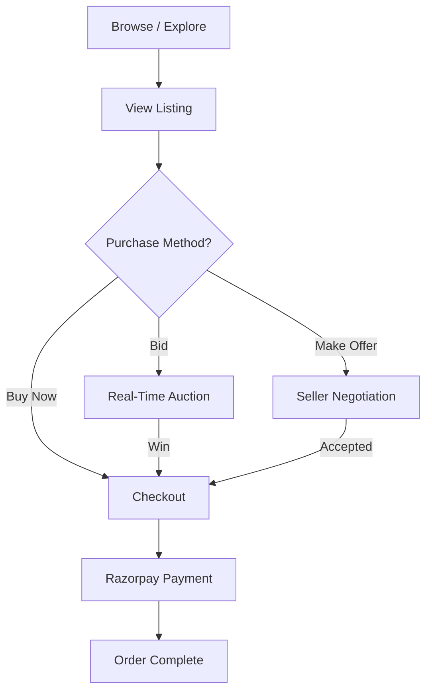
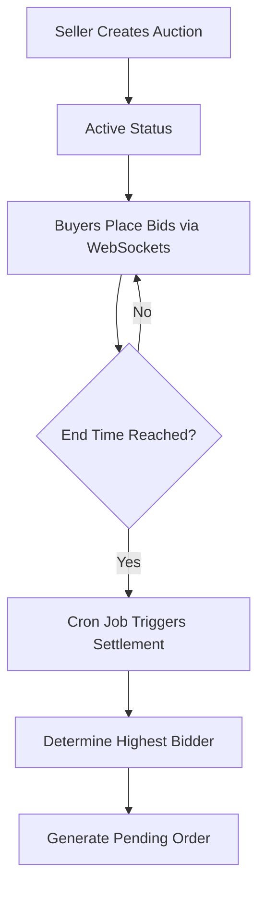
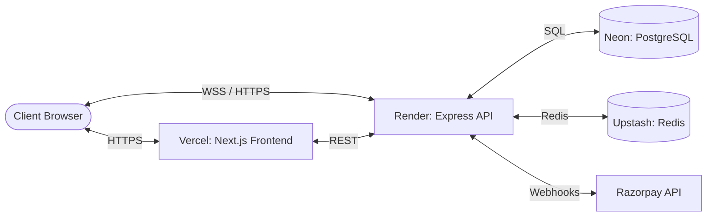
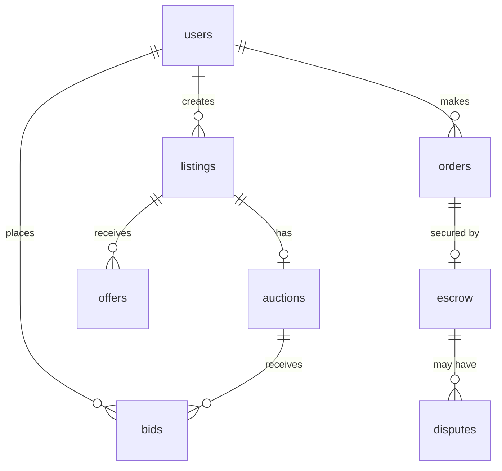

<div align="center">
  <pre>
 B I D C R A F T
 ────────────────
 Creator Marketplace • Auctions • Offers • Buy Now
  </pre>
  
  <p><strong>A full-stack marketplace supporting fixed-price purchases, live auctions, and negotiated offers.</strong></p>

  <p>
    <a href="#overview">Overview</a> •
    <a href="#key-features">Key Features</a> •
    <a href="#architecture">Architecture</a> •
    <a href="#tech-stack">Tech Stack</a> •
    <a href="#installation--setup">Installation</a>
  </p>
</div>

---

## 1. Overview

**BidCraft** is a production-grade creator marketplace built for flexibility and performance. Rather than limiting sellers to a single transaction model, BidCraft supports three parallel purchasing flows: **Buy Now (Fixed Price)**, **Live Auctions (Bidding)**, and **Make Offer (Negotiation)**.

Engineered with a decoupled Next.js 16 frontend and an Express REST API backend, BidCraft handles transactional consistency, escrow states, realtime bid updates, and background auction settlements at scale.

## 2. Key Features

- **Multi-Modal Transactions**: Support for fixed-price, standard bidding, and private offers.
- **Real-Time Auctions**: WebSockets (Socket.io) provide instant bid propagation and countdown synchronization.
- **Automated Settlement**: Configurable cron jobs (internal `node-cron` and external webhook triggers) evaluate auction endpoints, declare winners, and mutate escrow states.
- **Escrow & Dispute Management**: Secure lifecycle handling for funds, with dedicated dispute resolution pathways.
- **Seller Dashboard**: Comprehensive analytics, order tracking, and inventory management.
- **Responsive UI**: Built with Tailwind CSS, Shadcn, and Framer Motion for a premium, accessible mobile-first experience.

## 3. Product Experience

BidCraft emphasizes an artisan marketplace aesthetic. It departs from generic e-commerce templates by utilizing warm cream/off-white visual languages, clean typography, and restrained, high-density layouts optimized for serious buyers and collectors.

## 4. User Workflows

### Buyer Workflow


### Auction Lifecycle


## 5. Architecture

BidCraft follows a modern, decoupled architecture:
1. **Client**: Next.js 16 (App Router) serving responsive React Server Components and Client Components.
2. **API**: Express.js REST backend handling business logic and authorization.
3. **Real-time Layer**: Socket.io server integrated with Express for instant bid distribution.
4. **Data Layer**: PostgreSQL database managed via raw SQL migrations (`node-pg-migrate`).
5. **Caching & Rate Limiting**: Upstash Redis for high-performance session and request management.

### System Architecture Diagram


### Database Architecture


## 6. API Overview

The REST API is logically grouped into domains. All protected routes require a JWT Bearer token.

| Endpoint | Method | Purpose | Auth |
|---|---|---|---|
| `/api/auth/*` | POST | Login, Registration, Token Refresh | No |
| `/api/listings` | GET, POST | Fetch marketplace listings or create new | Yes (POST) |
| `/api/auctions/:id/bid` | POST | Place a bid on an active auction | Yes |
| `/api/offers` | GET, POST | Fetch user offers or submit new offer | Yes |
| `/api/orders` | POST | Finalize checkout and create order | Yes |
| `/api/cron/end-auctions` | POST | Settle expired auctions (Webhook) | CRON_SECRET |

## 7. Authentication & Authorization

- **Stateless Sessions**: JWT-based authentication with short-lived access tokens and secure refresh tokens.
- **Password Hashing**: `bcryptjs` applied prior to database insertion.
- **Role-Based Access**: Internal checks distinguish between generic users, admins, and listing owners (e.g., only a listing's owner can accept an offer).

## 8. Caching & Performance

Redis is utilized to mitigate database load for high-traffic read operations and to enforce rate limiting on sensitive endpoints (e.g., authentication, bidding). This ensures the application remains highly available during bidding wars.

## 9. Security

- **Input Validation**: `Joi` schema validation across all mutating API endpoints.
- **SQL Parameterization**: Complete utilization of `pg` parameterized queries to prevent SQL injection.
- **Rate Limiting**: `express-rate-limit` prevents brute-force and DDoS attempts.
- **Security Headers**: `helmet` enforces modern HTTP security policies.

## 10. Tech Stack

| Layer | Technology | Purpose |
|---|---|---|
| **Frontend** | Next.js 16, React 19 | Web application framework |
| **Styling** | Tailwind CSS, Shadcn | UI component architecture |
| **State/Data** | Zustand, SWR | Client state & data fetching |
| **Backend** | Node.js, Express | REST API server |
| **Database** | PostgreSQL, `node-pg-migrate` | Persistent data & migrations |
| **Cache/Limits** | Redis (Upstash) | High-performance caching |
| **Real-time** | Socket.io | Live auction updates |
| **Payments** | Razorpay | Transaction processing |
| **Media** | Cloudinary | Asset & image storage |

## 11. Project Structure

```text
BidCraft/
├── frontend/
│   ├── app/              # Next.js App Router pages
│   ├── components/       # Shared UI and domain components
│   ├── lib/              # Utility functions and API clients
│   └── store/            # Zustand state stores
├── backend/
│   ├── src/
│   │   ├── controllers/  # Route request handlers
│   │   ├── routes/       # Express route definitions
│   │   ├── services/     # Core business logic (e.g., settlement)
│   │   ├── middleware/   # Auth and validation guards
│   │   └── jobs/         # node-cron scheduled tasks
│   └── migrations/       # SQL database migrations
└── docs/                 # Architectural Decision Records (ADRs)
```

## 12. Installation & Setup

### Prerequisites
- Node.js (v20 or higher)
- PostgreSQL
- Redis (optional for local development, recommended)

### 1. Clone the Repository
```bash
git clone https://github.com/yourusername/bidcraft.git
cd bidcraft
```

### 2. Backend Setup
```bash
cd backend
npm install

# Create local environment configuration
cp .env.example .env

# Run database migrations
npm run migrate

# Start the development server
npm run dev
```

### 3. Frontend Setup
```bash
cd ../frontend
npm install

# Create local environment configuration
cp .env.example .env.local

# Start the Next.js development server
npm run dev
```

### Environment Variables
Key variables required for local operation:
- `DATABASE_URL`: PostgreSQL connection string.
- `JWT_SECRET`: Secret key for signing tokens.
- `REDIS_URL`: Upstash or local Redis connection.
- `CLOUDINARY_*`: Image hosting credentials.
- `RAZORPAY_*`: Payment gateway keys.
*(Refer to the `.env.example` files in both directories for the complete list.)*

## 13. Usage

1. **Register/Login**: Create an account to access buyer and seller features.
2. **Explore**: Navigate the marketplace using real-time filters and categories.
3. **Participate**: 
   - Add fixed-price items to your cart.
   - Enter active auctions and watch live bid updates.
   - Negotiate by submitting private offers.
4. **Checkout**: Securely complete purchases via Razorpay.
5. **Sell**: Access the Seller Dashboard to create listings, track orders, and manage escrow releases.

## 14. Testing

BidCraft implements testing on the backend utilizing Jest and Supertest for API validation.

```bash
# From the backend directory
npm test
```

## 15. Known Limitations

- **Cron Dependency**: Production auction settlement relies on external cron triggers (e.g., Vercel Cron) pinging the protected `/api/cron/end-auctions` endpoint to guarantee exact-time settlements across scaled instances.
- **Payment Gateway**: Currently tightly coupled to Razorpay; supporting Stripe/PayPal would require abstracting the payment service layer.

## 16. Future Improvements

- **Scalability**: Decouple the Socket.io server from the main Express API to allow independent horizontal scaling of the real-time layer.
- **Search**: Implement Elasticsearch or Typesense for advanced full-text search and typo tolerance.
- **Observability**: Integrate Datadog or Sentry for deeper tracing and error tracking in production.
- **Recommendations**: Add a collaborative filtering engine for personalized listing suggestions.

## 17. Screenshots

*(Screenshots can be added here by referencing the `/images` directory.)*

| Home | Marketplace Explore |
|:---:|:---:|
| *(Placeholder: Add home screenshot)* | *(Placeholder: Add explore screenshot)* |
| **Auction Bidding** | **Seller Dashboard** |
| *(Placeholder: Add auction screenshot)* | *(Placeholder: Add dashboard screenshot)* |

---
*Built with precision for creators and collectors.*
