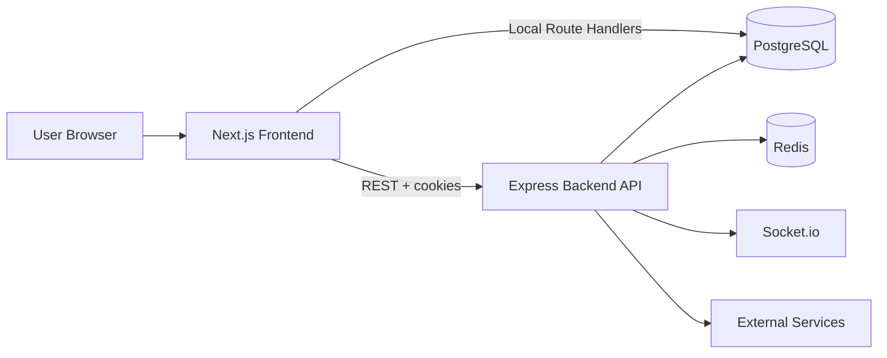

# BidCraft

BidCraft is a creator marketplace for discovering, buying, offering on, and auctioning unique items with escrow-backed transactions, seller tools, and marketplace trust features.

## 1. Project Overview

BidCraft aims to give creators, collectors, and buyers a single place to browse listings, join auctions, make offers, complete secure checkout, and manage orders with escrow protection. It addresses the gap in generic marketplaces by combining curated discovery, trust signals, auction support, and buyer protection using an escrow-first order flow.

## 2. Current Architecture

BidCraft uses a hybrid client-server architecture:
- **Frontend**: Renders the marketplace UI, product exploration, and checkout.
- **Backend**: Owns the core business logic, payment integrations, real-time auction broadcasting, and Escrow.

## 3. Frontend Stack
- **Framework**: Next.js 16 (App Router)
- **UI/Styling**: React 19, Tailwind CSS, Framer Motion
- **State Management**: Zustand
- **API Interactions**: Standard `fetch` with cookies & Prisma (Server routes)

## 4. Backend Stack
- **Framework**: Node.js, Express 5
- **Realtime**: Socket.io (for auction bidding and notifications)
- **Security & Validation**: JWT, Joi, bcryptjs, Helmet, Express Rate Limit
- **Media**: multer (for parsing before Cloudinary)

## 5. Database
- **Engine**: PostgreSQL
- **Migration & ORM**: node-pg-migrate (Backend), Prisma (Frontend)
- **Caching**: Upstash Redis for caching hot reads (fallback to mock in-memory store if env vars are missing).

## 6. Authentication
- **Flow**: Email/password registration -> OTP Verification -> JWT Issuance.
- **Tokens**: Access Token (short-lived) and Refresh Token (HTTP-only cookie).
- **Session**: Both frontend client state (Zustand) and server-side route guards respect the JWT.

## 7. Buying Flows (CURRENTLY WORKING)
- **Buy Now**: Direct purchase of fixed-price listings with instant Cart addition.
- **Make Offer**: Buyers can propose negotiated prices. Sellers can accept or reject.
- **Cart Checkout**: Multiple items can be checked out at once. Exactly one Razorpay transaction atomically resolves into individual orders and escrow records for each item.
- **Wishlist**: Users can save items to a personal wishlist.

## 8. Selling Flows (CURRENTLY WORKING)
- **Create Listing**: Sellers can post new items and configure the buying method (Fixed, Negotiable, or Auction).
- **Image Upload**: Seamless integration with Cloudinary.
- **Dashboard**: A unified dashboard for sellers to view listings and inbound orders.

## 9. Auction System (CURRENTLY WORKING)
- **Bidding**: Real-time bidding via Socket.io.
- **Deposits**: Required upfront deposit logic prior to placing bids.
- **Settlement**: Cron-based automated settlement for expired auctions. Zero-bid auctions safely expire.

## 10. Payment/Escrow System (CURRENTLY WORKING)
- **Gateway**: Razorpay integration for INR transactions.
- **Webhook & Verification**: HMAC signature verification secures the backend against payment spoofing.
- **Escrow**: Funds are locked in `escrow` records tied strictly to the order. Payouts require delivery confirmation or dispute resolution.

## 11. Cloudinary/Image Handling
- Images are uploaded directly through the backend to Cloudinary.
- URLs are stored as strings in PostgreSQL.

## 12. Required Environment Variables

### Backend (Runtime)
- `NODE_ENV=production`
- `PORT=8000`
- `DATABASE_URL` (PostgreSQL)
- `UPSTASH_REDIS_REST_URL` & `UPSTASH_REDIS_REST_TOKEN`
- `JWT_SECRET`
- `CRON_SECRET`
- `RAZORPAY_KEY_ID`, `RAZORPAY_KEY_SECRET`, `RAZORPAY_WEBHOOK_SECRET`
- `FRONTEND_ORIGIN` (Crucial for CORS)
- `CLOUDINARY_CLOUD_NAME`, `CLOUDINARY_API_KEY`, `CLOUDINARY_API_SECRET`
- `RESEND_API_KEY` (or SMTP fallbacks)

### Frontend (Build Args & Runtime)
- `NEXT_PUBLIC_API_URL` (Build time)
- `NEXT_PUBLIC_CLOUDINARY_CLOUD_NAME` (Build time)
- `INTERNAL_API_URL` (Runtime)
- `UPSTASH_REDIS_REST_URL` & `UPSTASH_REDIS_REST_TOKEN` (Runtime)
- `NODE_ENV=production`

## 13. Railway Deployment Requirements
- Deploy as two separate services (Frontend and Backend) connected to a PostgreSQL database.
- The **Frontend** can be built automatically using Nixpacks or the provided multi-stage `Dockerfile`.
- The **Backend** can be built automatically using Nixpacks or the provided multi-stage `Dockerfile`.
- Ensure all Production environment variables are mapped to both services.

## 14. Auction Cron Requirement
- The backend currently utilizes an internal `node-cron` instance in `server.js`.
- **For production deployments (especially scaled to multiple instances):** It is recommended to use an external scheduler (like Railway Cron or Upstash QStash) to hit `POST /api/cron/end-auctions` with the header `Authorization: Bearer <CRON_SECRET>` every minute, to prevent duplicate job execution and ensure reliable settlement.

## 15. Current Known Limitations
- Stub pages such as `/dashboard/messages`, `/dashboard/notifications`, and some deep admin routes exist but lack full implementation.
- Multi-level subcategory drill-down UX in the desktop navbar is simplified.

## 16. Post-Deployment Roadmap (P3)
1. **Onboarding Auto-Redirect**: Wire up automatic redirection for users who have not completed profile onboarding.
2. **Seller Dashboard Enhancements**: Build out the missing Analytics, Messages, and Payout tabs.
3. **Explore UX**: Enhance the Explore navigation with deeper subcategory drill-down trees.
4. **Post-Login Personalization**: Implement recommendation feeds based on previously viewed items and wishlist contents.
